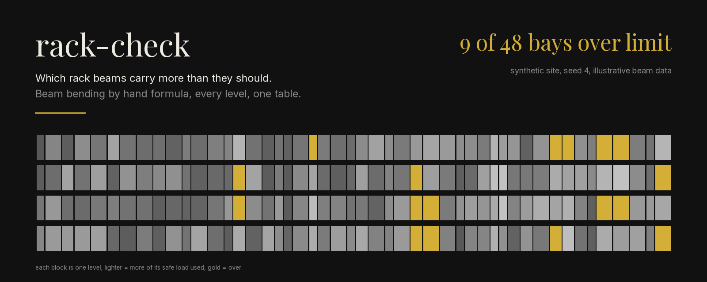
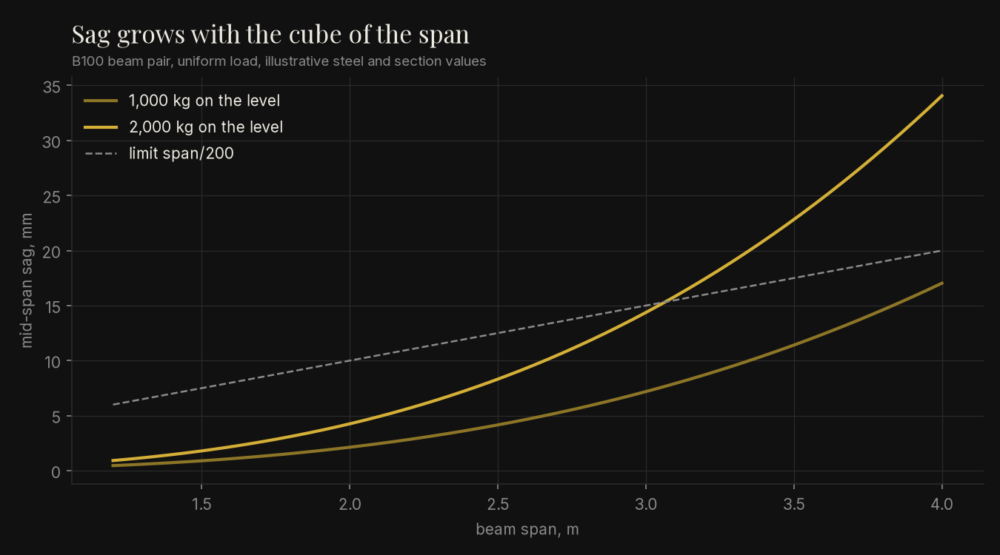
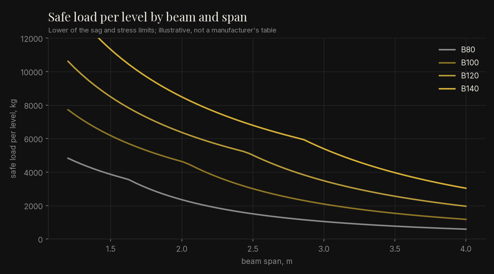

<p align="center">
  
</p>

<p align="center"><em>Synthetic data: an invented site of 48 bays and 192 levels, seed 4. Beam sections, steel grade, limits and prices are illustrative, not a structural design standard.</em></p>

Checks every level of a pallet rack against the load on it. For each level it works out how far
the beam pair sags under the pallets, how much load the pair can safely carry, and whether the
level passes. Failing levels get the cheapest beam from a small catalogue that would carry them,
or a note to reduce the load when none would. Output is a terminal summary, a CSV and a
one-page HTML report.

```bash
pip install -e ".[dev]"
python -m rack_check demo --html report.html   # 9 of 48 bays over their limit
pytest                                         # 100% coverage required
```

## Problem

Racks get installed for one product mix and then live through many. A bay fitted for light
cartons ends up holding drinks or paint, and nobody re-reads the load sign. Beams that carry
too much sag first, which is easy to miss and expensive to discover the hard way. A site
needs a quick list of which levels are over, by how much, and what replacing the beams
would cost, before it calls in the rack supplier.

## Method

1. **Bending** (`euler.py`): Euler-Bernoulli beam formulas for a simply supported beam. A
   point load gives sag `PL^3/48EI` and moment `PL/4`; a load spread along the beam gives
   `5WL^3/384EI` and `WL/8`. Pallets sitting on two beams are treated as spread load. This
   core is carried over from my earlier `beam` exercise, with its tests.
2. **Catalogue** (`profiles.toml`, `catalog.py`): steel stiffness and yield, the sag limit
   (span/200), a stress safety factor (1.5) and four beam sections with a price each. All
   illustrative, and replaceable with `--profiles`.
3. **Capacity** (`capacity.py`, numpy): for each level, the load at which the beam reaches
   the sag limit and the load at which it reaches the stress limit. The smaller governs, and
   two beams per level double it.
4. **Check** (`check.py`): load = pallets x pallet weight. Utilisation = load / capacity, and
   anything over 100% fails. For a failing level, the cheapest section that would pass, with
   its cost as `Decimal` for the beam pair.
5. **Output** (`io.py`, `report.py`): CSV in and out, and a static HTML page with no
   scripts or external files.

Derivation and hand-checked cases: [docs/derivation.md](docs/derivation.md).

## How to run

```bash
pip install -e ".[dev,figures]"
ruff check . && mypy && pytest
python -m rack_check demo --seed 4 --csv check.csv --html report.html
python -m rack_check check examples/levels.csv     # exit code 1 when any level fails
PYTHONPATH=src python scripts/make_figures.py
```

Own data: a CSV with `bay,level,span_m,profile,pallets,pallet_kg`. `examples/levels.csv` is
the synthetic seed 4 site.

## Result

Default run (asserted in `tests/test_cli.py`), 48 synthetic bays with 4 levels each:

| | Count |
|---|---:|
| Bays with at least one level over | **9** of 48 |
| Levels over | 17 of 192 |
| Fixable by a heavier beam in the catalogue | 9, illustrative cost 5,100.00 BRL |
| Too heavy for any beam in the catalogue | 8, all on 3.6 m spans |

The worst level carries 119% of its safe load. Across seeds 1 to 20 between 2 and 9 bays
fail. At these spans the sag limit governs every level; stress only takes over below about
1.6 m on the lightest beam, which is the kink in the curves below.


*Illustrative B100 beam pair. Doubling the span multiplies the sag by eight, so the long bays
are the ones that fail.*


*Illustrative catalogue. Each curve switches from the stress limit to the sag limit where it
bends.*

## Limits

- Not a structural design tool. The beam sections, steel grade, limits and prices are
  illustrative. Real rack capacity comes from the manufacturer's load tables and a check by a
  qualified engineer, under the rack standard that applies where you are.
- Only the beams are checked. Upright frames, base plates, anchors, beam connectors, impact
  damage and seismic loads are not, and those often govern.
- Every beam is treated as simply supported with an evenly spread load. Real connectors give
  some end fixity, which helps, and a pallet with its weight on two boards is closer to two
  point loads, which hurts a little.
- Data is synthetic. Pallet weights should come from a scale or the product master, not a
  guess, and the fix cost leaves out labour and downtime.
- Technology choices: Python because the work is a few formulas over a table; numpy so the
  whole site is checked as arrays in one pass; TOML for the catalogue so a supplier's values
  drop in without code; `Decimal` for money; a static HTML page because a safety report has
  to open on any machine and be printable.
- README principle: honesty about limits. A rack check that looks authoritative but is not is
  worse than none, so the illustrative label sits on every output.
